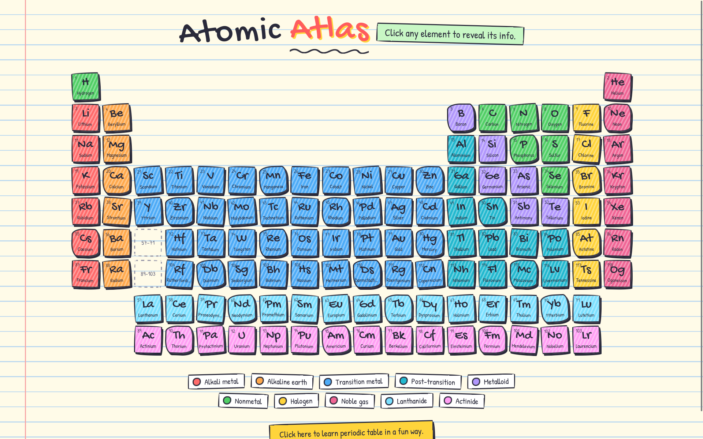
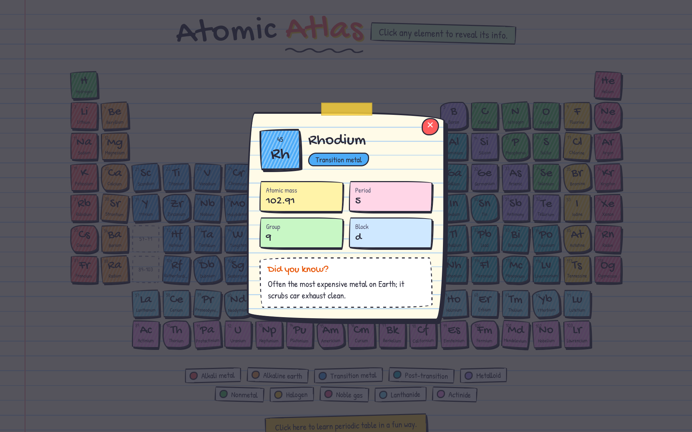
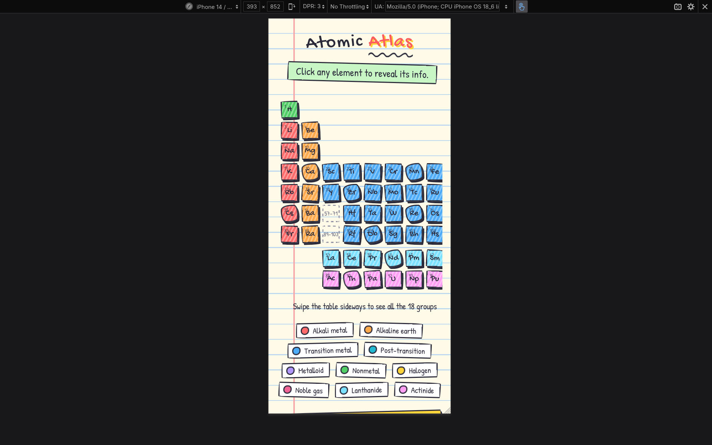

# Atomic Atlas

A modern interactive periodic table. Click any element to see its symbol, atomic mass, period, group, block and a fun science fact. Built with plain HTML, CSS and JavaScript.



## Try it

https://zeti1223.github.io/Atomic-Atlas/

## Features

- All 118 elements in the correct 18-column layout
- Click an element to open a card with its number, symbol, name, mass, period, group, block and a fact
- Elements are colour coded by category, with a legend at the bottom
- Data lives in a separate `elements.json` file, so it is easy to edit or add to
- Works on phones too, where the table scrolls sideways
- No frameworks and no libraries, just HTML, CSS and JavaScript

## Running locally

```bash
git clone https://github.com/Yuser00123/Atomic-Atlas
cd Atomic-Atlas
python3 -m http.server
```

Then open http://localhost:8000 in your browser.

You need a small local server because the page loads `elements.json` with `fetch()`, and browsers block that when you open the file directly.

## Built with

- HTML
- CSS (CSS Grid and flexbox, no frameworks)
- JavaScript (no libraries)
- `elements.json` for the element data

## Screenshots

| Element card | On mobile |
| --- | --- |
|  |  |
